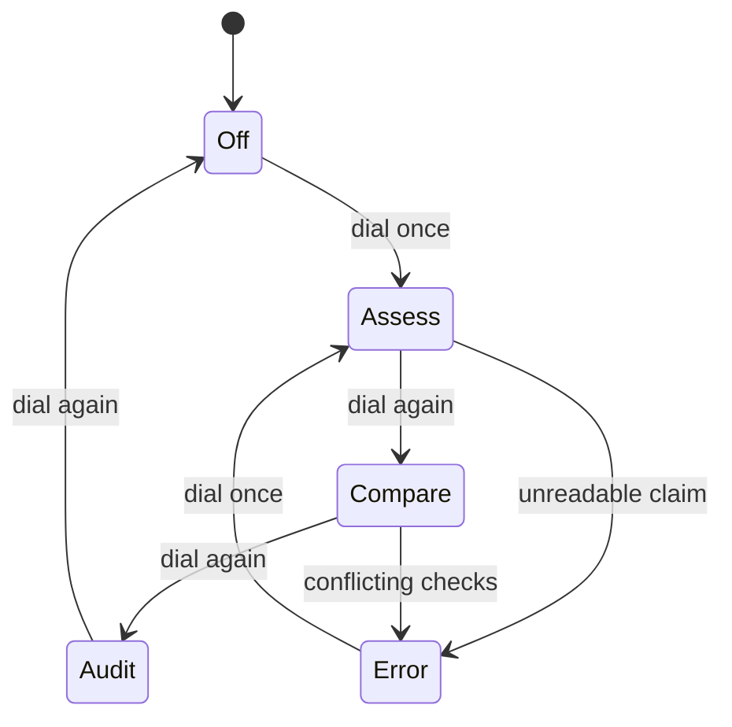

# Operation

The machine has three modes and no menus. Switching is done with the single
control, which is a dial with four detents: off, and one for each mode.

## Modes

### Assess

The default. You present a claim on the reader surface, then press the dial once.
The unit returns a verdict with the check it would settle it by.

### Compare

Present two claims and the unit reports whether they are **the same claim stated
differently**, which is a question about structure rather than meaning. It is the
only mode that can return `E-11`, and only when the two claims share a subject
but name different checks.

### Audit

Present a claim and evidence. The unit reports whether the evidence addresses the
check the claim names. It does not score the evidence, and it will not tell you
whether the evidence is good.

## The procedure, in full

1. Place the claim flat on the reader surface, text toward the lens.
2. Press the dial once and release it. Holding it does nothing.
3. Read the verdict on the display, then read the second line.
4. If the second line names a check, run that check. The machine will not.

### Reading the second line

The second line is where the machine earns its name. It never repeats the claim
and never summarises it; it names the observation that would settle the matter,
in the imperative, with the smallest scope that would do.

#### When there is no second line

`Unfalsifiable` and `Malformed` verdicts have no second line, because there is no
observation to name. A blank second line is not a fault; it is the finding.

## What the display will not show

A confidence figure. A probability. A percentage of any kind. If you see one, the
display is failing in a way the self-test does not catch, and the unit should be
returned rather than trusted.
