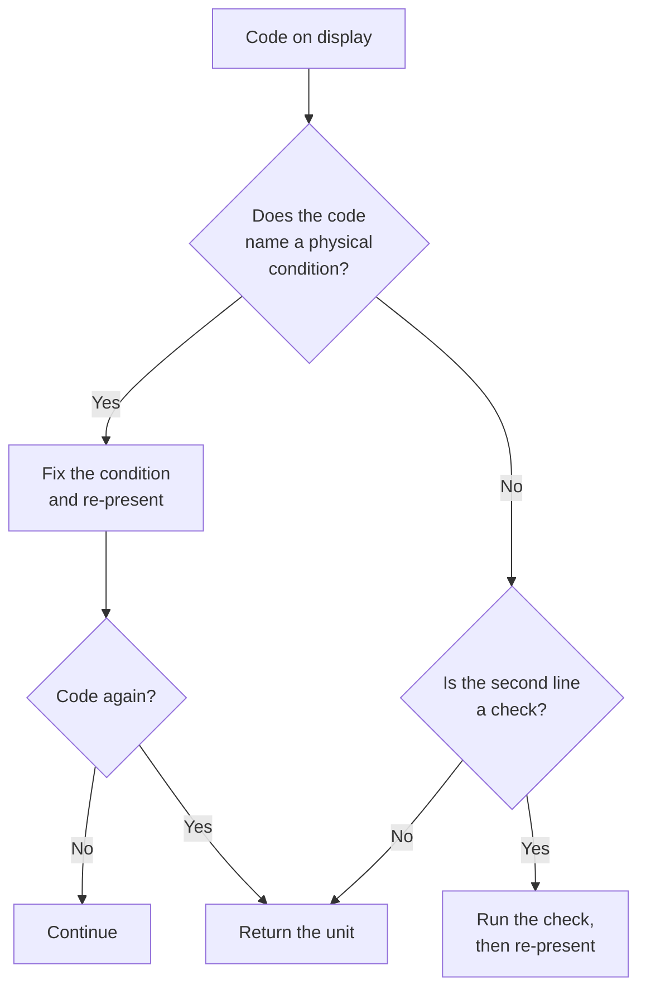

# Error codes

Codes are stable across firmware revisions. A code means the same thing in every
unit, and the response column is written to be followed literally.

| Code | Meaning | First response |
| --- | --- | --- |
| `E-02` | Reader surface obstructed | Clear the surface, re-present the claim |
| `E-04` | Supply below 11.4 V | Replace the supply, not the cable |
| `E-07` | Lens capped during self-test | Uncap and power-cycle once |
| `E-09` | Claim exceeds the reader area | Present the claim in two parts |
| `E-11` | Two claims name different checks | Settle one before comparing |
| `E-13` | Evidence does not address the named check | Re-present with the right evidence |

## The two that are not faults

### E-09

Long claims are not errors of the machine. The reader area is a physical limit
and the correct response is to reduce scope, which usually improves the claim.

### E-11

Comparison is refused rather than approximated. A machine that guessed when
checks disagreed would be answering a different question than the one asked.

#### Reading E-11 as a result

An `E-11` is often the most informative output of a session: it says the two
claims you believed were alternatives are actually settled by different
observations, which means they were never alternatives.

## The one that is a fault

`E-13` is the only code that can indicate a broken reader, and only if the
evidence demonstrably addresses the check. Before returning the unit, verify the
second line of the previous verdict; nine of ten `E-13` reports are a claim whose
named check was misread.

