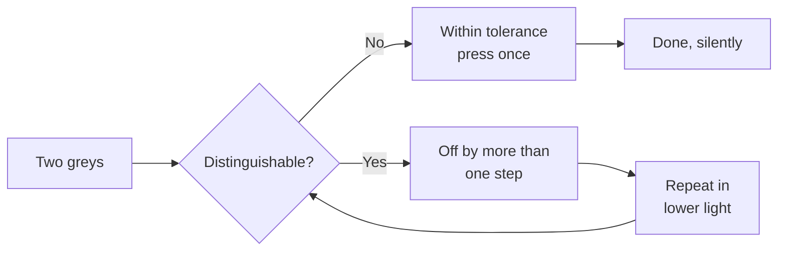

# Maintenance

The unit is designed to be maintained by the person who owns it, with no tools
beyond a lint-free cloth and a calendar.

## Schedule

| Interval | Task | Time |
| --- | --- | --- |
| Weekly | Wipe the reader surface | 20 s |
| Monthly | Check the intake for dust | 1 min |
| Yearly | Verify the display calibration | 4 min |
| Never | Open the case | — |

### Weekly: the reader surface

A fingerprint on the surface does not change the verdict, but it changes the
second line, because the machine reads the claim's edges to decide scope. A
smudged edge produces a wider scope than the claim deserves.

### Monthly: the intake

Hold a sheet of paper near the intake; the vent should pull it. If it does not,
the unit is thermally throttled and will still work while running warmer than
designed.

#### A note on compressed air

Do not use it. The intake is a single opening over a sensor that tolerates air
movement and not air pressure.

## Yearly: display calibration

The calibration is a comparison, not an adjustment: the unit shows two greys and
asks you which is darker. If you cannot decide, the display is within tolerance
and you press the dial once to confirm. This is the only procedure in the manual
that produces no output when it succeeds.

## The maintenance ledger

Keep it on paper, next to the unit. The machine has no log, on purpose: a log
becomes a duty, and a duty becomes a reason to skip the weekly wipe.
