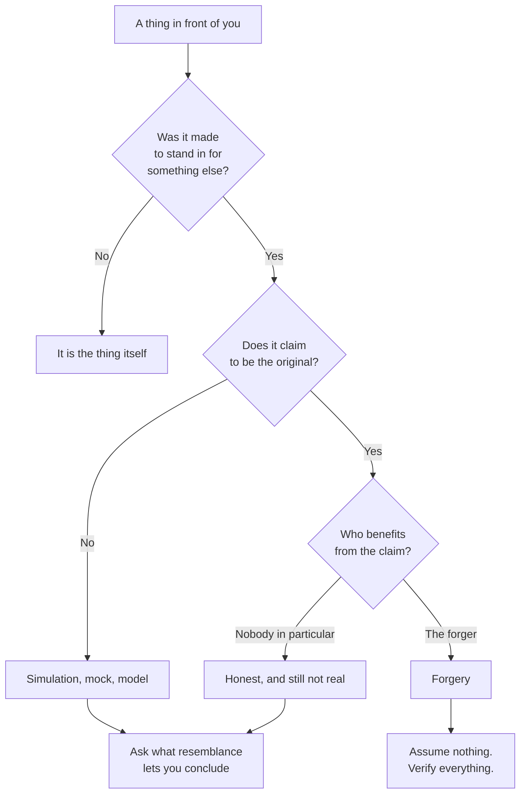

# What Counts as a Fake

Every fake is an answer to the same question: *what is this thing standing in
for?* A replica copies a shape. A forgery copies a shape and lies about its
origin. A simulation copies a behaviour. A mock copies an interface and admits
it is a mock, which is the only honest kind of fake there is in software.

The distinction is not academic. It decides what you are allowed to conclude
from the thing in front of you. You may conclude a great deal from a replica:
that the buttons are where the diagram says they are. You may conclude almost
nothing about the original from a forgery, because the forger chose which
details to keep.

Most of the confusion in this field comes from borrowing language. We say a
model *hallucinates*, as though it were a witness under oath. We say a test
double *lies*, as though it had an obligation to the truth. The vocabulary of
deception gets used to describe machinery that has no commitments at all.

The useful question is never "is this real?" but "what was this made to
resemble, and what does resembling it let me claim?"

Keep that diagram in mind for the rest of this document. Everything that follows
is a variation on the branch that ends in *ask what resemblance lets you
conclude* — the branch where a fake is a tool rather than a swindle.
