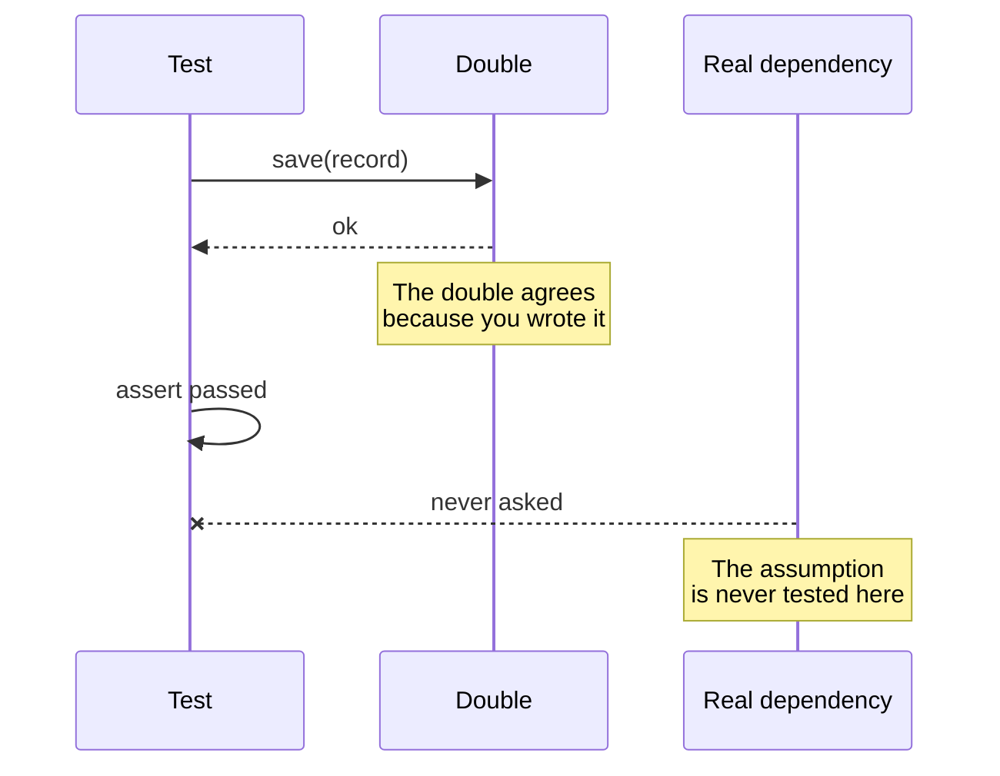

# The Honest Lie of the Test Double

A test suite is a machine for being wrong early and cheaply. The test double is
its most useful component and its least understood one.

Four kinds, and the differences matter:

- A **stub** returns a canned answer. It says nothing about how it was called.
- A **spy** returns a canned answer and remembers the conversation.
- A **mock** is a spy with expectations: it fails when the conversation does not
  happen.
- A **fake** is a real, working implementation of something simpler — an
  in-memory database instead of a network one.

The first three are lies about the outside world. The fourth is a small truth
held in the wrong size of container. Teams that reach for a fake before a mock
tend to have test suites that survive refactoring, because a fake has behaviour
instead of expectations. Expectations are the part of a test that ages worst.

There is a subtler trap. A test double encodes your *model* of the dependency,
not the dependency. When the real service starts returning a field you did not
imagine, the test will keep passing and keep telling you the world is shaped
like your assumptions. That is the moment the double stops being a tool and
starts being an alibi.

A double is honest when you know exactly which sentence of your test it is
answering, and dishonest when it starts answering questions you never asked it.
