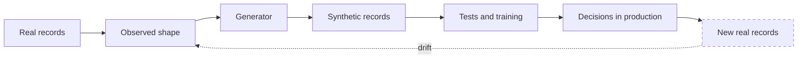

# Synthetic Data and the Shape of Reality

Synthetic data is the most consequential fake we make, because it is a fake that
teaches. Whatever generated it becomes the teacher of whatever is trained on it.

The pleasant version of the story: you cannot ship production records into a
test environment, so you generate records that look like them. Names, addresses,
timestamps, the occasional malformed row. The suite exercises paths that real
data would reach only in production, and nobody's personal information travels
with it.

The unpleasant version: your generator has opinions. It produces round numbers
where reality is ragged. It never produces the record with a null in a column
that is required but historically nullable. It has a uniform distribution where
reality has a spike. Everything you train or test on it inherits those opinions,
and they arrive disguised as facts.

Drift is where this bites hardest. A generator is a photograph of the data at the
moment someone looked. The system around it keeps moving.

The loop is the whole point. A synthetic dataset that is generated once and
trusted forever is a snapshot pretending to be a mirror. The teams that use this
well regenerate on a schedule, compare distributions, and keep a small slice of
genuinely real data aside to check that the fake still resembles it.
