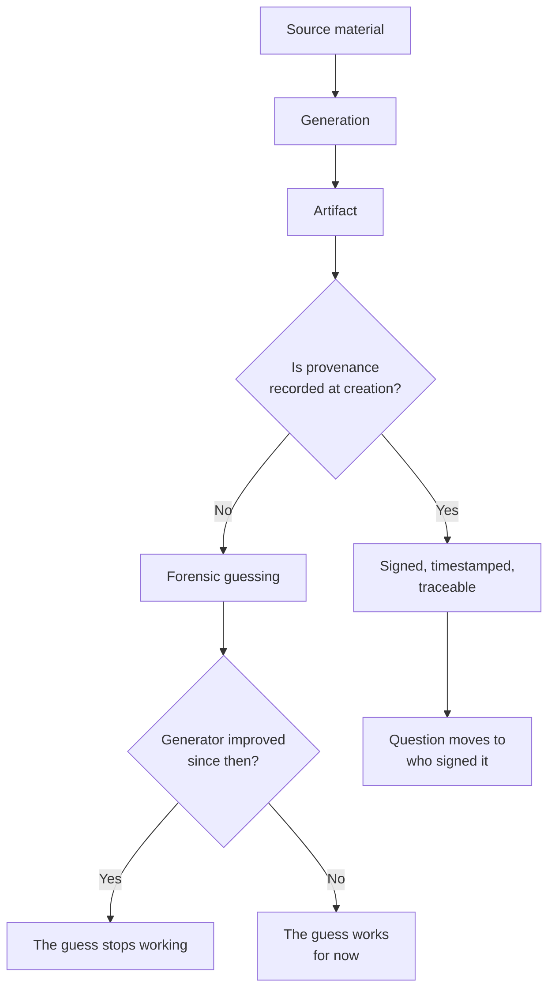

# The Imitation Engine

A generative model is a device for producing things that could have been in its
training data. That sentence is deliberately flat. It contains no claim about
understanding, intention or truth, and most confusion about these systems comes
from adding one.

The imitation is statistical, not authorial. It has no position on whether the
sentence it produced is accurate, because accuracy is a relationship between a
sentence and a world, and the model only ever saw sentences. When it produces a
citation that does not exist, it is doing precisely what it was built to do:
continuing a pattern that looked like a citation.

What changes at scale is not the nature of the imitation but the cost of
mistaking it. A blurred photograph of an event that never happened used to
require a darkroom and a patient forger. The same image now takes seconds, and
the interesting question moves from *can it be faked* to *who can prove what*.

Provenance is the answer that keeps surfacing: not detecting fakes after the
fact, but recording where a thing came from while it is being made. It is
unglamorous, it is boring infrastructure, and it is the only approach that
survives a better generator.

Detecting a fake is a race you can lose. Recording provenance is a decision you
make once, before the race starts.
