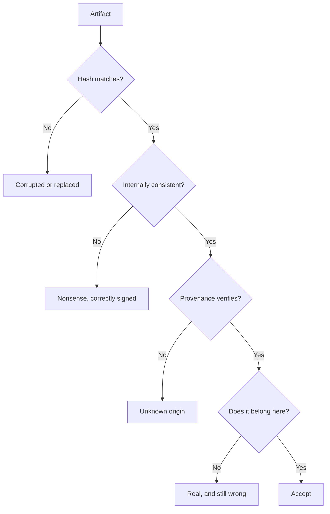

# How We Tell the Difference

Verification is a stack, and each layer answers a narrower question than the one
below it.

**Identity.** A hash tells you whether two byte sequences are the same. It says
nothing about whether the content is true, useful or wanted — only that nothing
changed since someone computed it. This is why a checksum file next to a download
is a real safeguard and a signature on a release is a stronger one: one detects
corruption, the other attributes origin.

**Consistency.** Cross-checks catch what hashes cannot. A record that claims a
shipment left after it arrived is internally valid and externally absurd. Rules
of this kind are cheap to write and embarrassing to omit.

**Provenance.** Who made this, with what, and when. This is the layer that
survives a competent forger, because it does not examine the artifact for
tell-tale signs; it asks the artifact where it came from.

**Judgement.** The last layer is a human deciding whether the thing should exist
at all. No amount of cryptography helps here, and this is the layer people skip
when they have automated the other three.

Notice how many ways there are to be wrong while every technical check passes.
That is not a reason to skip the checks; it is a reason to stop pretending they
add up to certainty.
