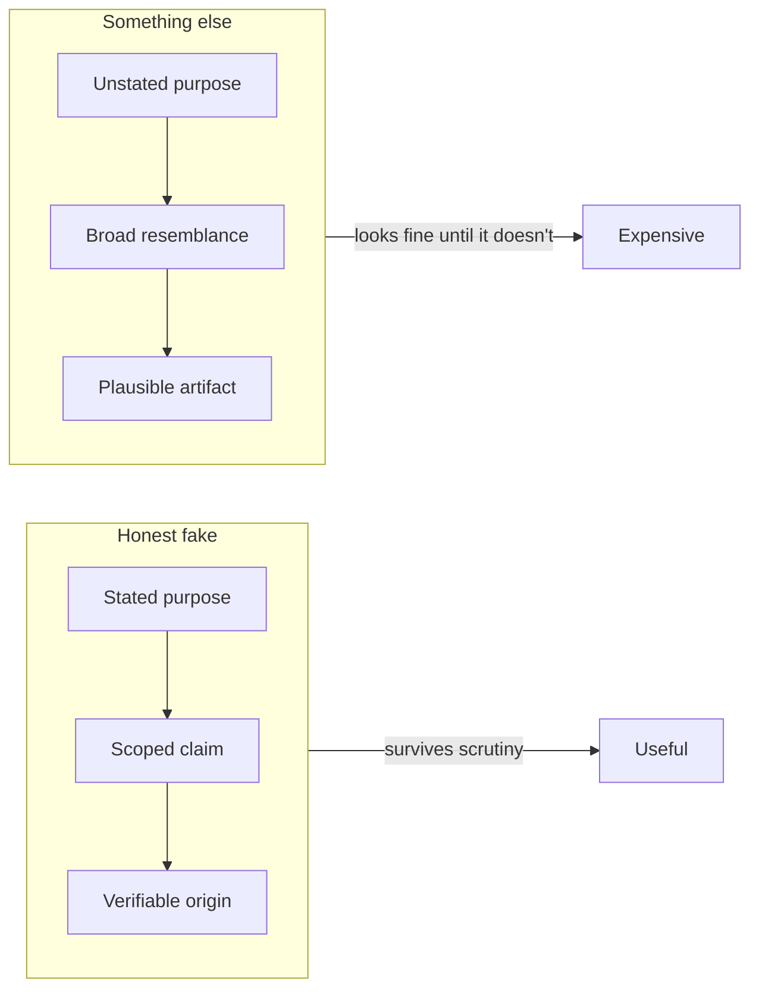

# A Fake That Tells the Truth

You are reading a fake.

These six chapters are original text written to be published by a PDF toolkit,
about a fictional field guide that does not exist. The table of contents is
generated, the diagrams are rendered by a converter, and the whole thing exists
so that a build can fail loudly if any of those steps stops working. The cover
page is decoration. The value is that a broken pipeline produces an obviously
broken document instead of a quiet one.

That is the good kind of fake: one whose purpose is to expose the machinery
around it. Not a forgery, which hides its origin, but a control sample — a known
quantity you can compare against.

Which brings the argument back to where it started. Fakes are not a moral
category; they are a design decision with a stated purpose or an unstated one.
Mock objects, synthetic datasets, generated voices, imitation models: every one
of them is fine when the purpose is legible and the resemblance is honestly
scoped, and every one of them is dangerous when the resemblance is the only
thing anyone checks.

- [x] The purpose of the fake is written down
- [x] The resemblance is scoped to what you actually claim
- [ ] Someone outside the team can verify the origin 🧪
- [ ] The fake is regenerated as reality moves

The last two boxes are the ones that get left unticked in production, and they
are the only two that matter once the system has been running for a year.

Thank you for reading the fixture. It is, as promised, entirely fake — and one
hundred percent accurate about the machinery that produced it. 🔍
